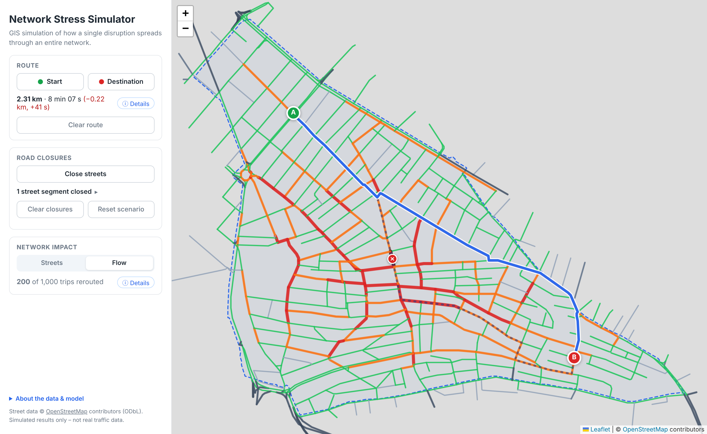

# Network Stress Simulator

**GIS simulation of how a single disruption spreads through an entire network.**

Close a street and watch two things happen at once: your own route is recalculated,
and 1,000 simulated trips redistribute across the whole street network.
The demo uses the street network of Vračar (Belgrade, Serbia), but the question it
answers applies to any infrastructure network: *what happens to the rest of the
system when one link fails?*

**▶ Live demo:** https://mimicgoran.github.io/network-stress-simulator/



---

## What you can do

1. **Pick a start (A) and a destination (B)** inside Vračar → the fastest legal route is drawn.
2. **Close one or more street segments** → the route is recalculated instantly; the original
   route stays visible as a dotted line, with the extra distance and time.
3. **Switch to the *Flow* view** → see how many of the 1,000 simulated trips use each street,
   and how that flow shifts to alternative streets after a closure.
4. **Open *Details*** → trips affected, trips rerouted, trips left without any route,
   total extra travel time and distance across the network.

Closures can be reopened one by one, cleared, or the whole scenario can be reset.

## Two analytical processes on one network

| | Individual routing | Network impact simulation |
|---|---|---|
| Question | How does a closure change *my* trip? | How does a closure affect *everyone*? |
| Input | One start and destination chosen on the map | 1,000 synthetic trips (fixed random seed) |
| Output | New route, extra distance and time | Flow per street, rerouted and cut-off trips |

Both use the same street graph, the same closures and the same routing algorithm.
A closure that is *not* on your route can still change the flow on streets around it.

## How it works

### 1. Network preparation (Python, run once)
`scripts/01_download_network.py`

- Street network for cars downloaded from **OpenStreetMap** with **OSMnx**, as a directed graph.
- Area: the Vračar municipality boundary (OSM relation 5731335) **plus a 500 m buffer** for
  routing, so detours near the boundary stay realistic. Only Vračar + 50 m is shown and clickable.
- **One-way streets** – an edge exists only in the allowed direction.
- **OSM turn restrictions** (`type=restriction`) – 241 applied, converted into forbidden
  edge-to-edge transitions. Restrictions that cannot be mapped reliably (time-dependent,
  "via way", ambiguous) are reported and skipped, not guessed.
- **No U-turns** at intersections (allowed only at dead ends).
- **Traffic lights** – OSM `highway=traffic_signals` nodes snapped to the nearest junction
  (163 signalized junctions).
- Only the **strongly connected part of the turn graph** is kept, so a route always exists
  between any two points when nothing is closed.
- Output: a compact `docs/data/network.json` (≈ 340 KB) plus a GeoPackage for checking in QGIS.

### 2. Routing (JavaScript, in the browser)
`docs/js/router.js`

- Dijkstra's algorithm on an **edge-based (turn) graph**: the state is the street segment a
  vehicle is on, not the intersection, so every turn can be checked against the restrictions.
- Closed segments are excluded in both directions.
- Cost = estimated travel time:
  - driving at **85 % of the speed limit** between junctions,
  - plus a **junction delay** depending on the manoeuvre:

    | | straight | right | left |
    |---|---|---|---|
    | no traffic lights | 3 s | 6 s | 10 s |
    | traffic lights | 17 s | 15 s | 25 s |

  The parameters are estimates, chosen so that trips get realistic durations
  (about 21 km/h on average, typical for daytime driving in central Belgrade).
  They are not measured values and not real-time traffic.

### 3. Network impact simulation (JavaScript, in the browser)
`scripts/02_generate_trips.py`, `docs/js/simulation.js`

- 1,000 synthetic trips between random intersections in Vračar (fixed seed `42`,
  minimum straight-line distance 400 m).
- **Baseline flow** = number of simulated trips using each street segment.
- After a closure, **only the trips whose route used a closed segment are re-routed**.
  This is exact, not an approximation: closing a street only removes options, so no other
  trip can find a better route.
- Trips with no remaining route are **counted separately** and excluded from the extra
  time / distance, so the network never looks "better" because trips disappeared.

### Verification
- Routes were checked against an independent **NetworkX** implementation of the same model:
  **400 / 400** random routes identical, none using a forbidden turn or a one-way street
  in the wrong direction.
- Incremental re-routing was checked against a full re-run of all 1,000 trips:
  **identical flow in 30 / 30** random closure scenarios.
- Browser tests (Playwright) cover route selection, closures on and off the route, multiple
  closures, reopening, closing every exit, changing A/B, reset and rapid repeated closures.
- Performance: one route ≈ 0.25 ms; full simulation at start ≈ 0.25 s;
  one closure including re-routing ≈ 30–90 ms.

## Key numbers

| | |
|---|---|
| Routing graph | 1,004 nodes, 2,063 directed edges |
| Street segments shown | 816 (Vračar + 50 m) |
| OSM turn restrictions applied | 241 (222 forbidden turns in the final graph) |
| Junctions with traffic lights | 163 |
| Synthetic trips | 1,000 (seed 42) |
| OSM data extracted | 23 Nov 2026 |

## Limitations – please read

This is a **portfolio demo of network analysis**, not a traffic model or a navigation app.

- **Flow is not traffic.** It is the number of *simulated trips* using a street – a sample
  showing relative importance, not a vehicle count and not tied to any time period.
- Trips start and end at **random points inside Vračar**. Real demand (homes, jobs, schools)
  and through-traffic from other districts are not modelled.
- **No congestion**: street capacity, queues, traffic-light cycles, real driver behaviour
  and traffic equilibrium are not modelled. Travel-time parameters are estimates.
- Turn restrictions are only as complete as OpenStreetMap; time-dependent restrictions are ignored.
- A trip reported as "no route available" has no legal path *within the modelled network*
  (Vračar + 500 m).

## Beyond streets: the same concepts for other networks

The street network is a visual, easy-to-understand example. The underlying building blocks –
**graphs, nodes and links, connectivity, critical links, alternative paths and the
consequences of failure** – are the same in other infrastructure networks:

- **Water supply** – which parts of the network lose their connection to a source after a pipe break.
- **Power grid** – topological connectivity and the potential impact of losing a line or substation.
- **Telecommunications** – redundancy, alternative links and critical nodes.

The physics are different: routing traffic is not a hydraulic simulation or a power-flow
calculation, and this app does not claim to model those systems. What carries over is the
network-analysis approach.

## Project structure

```
├── scripts/
│   ├── check_env.py              # environment check
│   ├── 01_download_network.py    # OSM → routing graph → docs/data/network.json
│   └── 02_generate_trips.py      # synthetic trips → docs/data/trips.json
├── docs/                         # the web app (served by GitHub Pages)
│   ├── index.html
│   ├── css/style.css
│   ├── js/network.js             # data loading + travel-time model
│   ├── js/router.js              # turn-aware Dijkstra
│   ├── js/simulation.js          # network flow + closure impact
│   ├── js/app.js                 # map and user interface
│   └── data/                     # network.json, trips.json, vracar_boundary.geojson
├── assets/screenshot.png
└── requirements.txt
```

## Run locally

Requires Python 3.12 or newer (tested with 3.12, 3.13 and 3.14). Commands for Windows PowerShell:

```powershell
py -3.14 -m venv .venv
.venv\Scripts\python.exe -m pip install -r requirements.txt

# start the web app (data is already included)
.venv\Scripts\python.exe -m http.server 8000 --directory docs
# open http://localhost:8000
```

To rebuild the data from OpenStreetMap:

```powershell
.venv\Scripts\python.exe scripts\check_env.py
.venv\Scripts\python.exe scripts\01_download_network.py
.venv\Scripts\python.exe scripts\02_generate_trips.py
```

Run `02_generate_trips.py` again whenever the network is rebuilt: trips refer to node numbers in `network.json`.

## Tech stack

Python · OSMnx · NetworkX · GeoPandas · Shapely · JavaScript · Leaflet · GitHub Pages.
No backend, no database, no paid APIs – everything runs in the browser.

## Data and licence

- Street data © [OpenStreetMap contributors](https://www.openstreetmap.org/copyright),
  available under the [Open Database License (ODbL)](https://opendatacommons.org/licenses/odbl/).
  The files in `docs/data/` are derived from OpenStreetMap and are shared under the same licence.
- Map tiles © OpenStreetMap contributors.
- Code: [MIT License](LICENSE).
